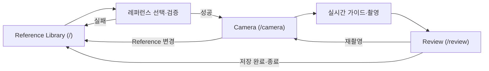

# 찰칵 (Chal-Kak)

**찰칵**은 레퍼런스 인물 사진의 **포즈 또는 인물 중심 구도**를 따라 촬영할 수 있도록 실시간 가이드를 제공하는 모바일 웹 서비스입니다. 별도의 앱 설치 없이 스마트폰 브라우저에서 사용하며, 카메라 영상의 포즈 분석은 사용자 기기에서 처리하는 것을 원칙으로 합니다.

> **설계 기준:** Reference-first · On-device Analysis · Pose/Composition 분리 · One Cue Guidance  
> **개발 현황:** `main`에 Next.js 초기 프로젝트와 일부 기본 화면·타입이 구성되어 있습니다. 아래에 설명하는 완성형 촬영·분석·저장 기능이 모두 연결된 상태는 아닙니다.

## 핵심 사용자 흐름



- **Reference-first:** 첫 화면에서 제공된 레퍼런스를 탐색하거나 직접 사진을 추가합니다. **레퍼런스를 선택하기 전에는 카메라 권한을 요청하지 않습니다.**
- **선택 후 촬영:** 유효한 레퍼런스를 선택하면 추가 시작 버튼 없이 카메라 화면으로 이동합니다. 카메라 권한은 이 시점에 요청합니다.
- **촬영 후 Review:** 자동·수동 촬영 후 결과를 확인합니다. 재촬영은 같은 레퍼런스를 유지하며, 촬영 완료 시 라이브러리로 돌아갑니다. 기기 다운로드와 클라우드 사진첩 저장은 별개의 동작입니다.

## 주요 기능과 설계 원칙

| 기능 | 설명 |
|---|---|
| 포즈 따라하기 | 2D 관절각·신체 Segment 방향 등을 이용해 자세를 비교합니다. 레퍼런스 인물의 화면상 위치와 크기는 기본 포즈 판정에서 제외합니다. |
| 사진 전체 따라찍기 | 포즈 비교에 더해 인물의 위치·크기·프레이밍·여백을 비교합니다. |
| 실시간 가이드 | MediaPipe Pose Landmarker 분석 결과로 Target Skeleton과 Composition Frame을 Canvas에 표시합니다. 레퍼런스 원본 이미지를 카메라 위에 반투명하게 덮는 방식을 기본으로 하지 않습니다. |
| One Cue·음성 안내 | 우선순위가 높은 수정 행동 하나를 선택해 음성으로 안내하고, 중복·빈번한 안내를 제어합니다. |
| 자동·수동 촬영 | 사용자가 직접 촬영하거나, 판정 조건·움직임·자세 유지 시간을 충족했을 때 자동으로 촬영합니다. |
| 촬영 결과 분석 | 촬영 시점의 매칭 결과를 보존하고 포즈·구도·방향·선명도 등을 진단합니다. |
| 레퍼런스 관리 | 기본 레퍼런스와 사용자 이미지의 검증·분석·보관을 지원합니다. |
| 사진첩·공유 | 사용자 인증, 사진 저장·조회·삭제, 공유 링크를 제공합니다. |

**Pose Matching과 Composition Matching은 서로 다른 모듈**입니다. 실시간 촬영 가능 여부는 단순한 0~100 점수가 아니라 매칭 조건으로 판단하며, 촬영 후 진단용 점수와 구분합니다. 단안 카메라 기반 3D 정보는 보조 신호로 취급합니다.

## 기술 구성

| 영역 | 기술 | 역할 |
|---|---|---|
| 웹 앱 | Next.js App Router · React · TypeScript | 페이지, 사용자 인터페이스, 클라이언트/서버 로직 |
| 스타일 | Tailwind CSS | 모바일 UI |
| 카메라·그래픽 | MediaDevices API · Canvas 2D | 카메라 스트림·오버레이·촬영 |
| 포즈·얼굴 인식 | MediaPipe Pose / Face Landmarker | 브라우저 내 Landmark 추론 |
| 비교·가이드 | TypeScript 모듈 | Pose/Composition/Orientation · Match Policy · One Cue |
| 음성 | Web Speech API | 음성 안내 |
| 로컬 저장 | IndexedDB | 사용자 레퍼런스 캐시·로컬 보관 |
| 서비스 데이터 | Supabase Auth · PostgreSQL · Storage | 인증·사진첩·레퍼런스·공유 |
| 배포 | Vercel | Next.js 호스팅 및 HTTPS |

실시간 카메라 프레임 분석을 위한 별도의 Python 서버는 사용하지 않습니다. OpenCV.js는 기본 필수 의존성이 아닙니다.

> **구현과 설계의 구분:** 현재 `package.json`에는 Next.js/React 등 초기 개발 의존성이 있으며, MediaPipe·Supabase와의 정식 연동은 위 시스템 아키텍처를 기준으로 개발합니다.

## 로컬 개발 환경

**요구 사항:** Node.js **20.9 이상**, npm, Git. 의존성은 저장소의 `package-lock.json`을 기준으로 설치합니다.

```bash
# 저장소 복제
git clone https://github.com/Potato-Love/chal-kak.git
cd chal-kak

# 의존성 설치
npm ci

# 개발 서버 실행
npm run dev
```

개발 서버는 기본적으로 **http://localhost:3000** 에서 확인할 수 있습니다.

### 검사 및 빌드

```bash
npm run lint         # ESLint
npx tsc --noEmit     # TypeScript 타입 검사
npm run build        # 프로덕션 빌드
npm run start        # 빌드 결과 실행
```

현재 `package.json`에는 `test` 스크립트가 정의되어 있지 않습니다. 자동화 테스트는 테스트 도구와 스크립트를 설정한 후 실행합니다.

## 작업 디렉터리

```text
chal-kak/
├── src/
│   ├── app/                  # App Router 페이지 · 현재 일부는 자리표시자
│   │   ├── page.tsx          # / : Reference Library로 구성할 진입 화면
│   │   ├── camera/           # /camera
│   │   └── gallery/          # /gallery
│   ├── components/           # 공용 UI
│   ├── features/             # camera, reference, pose, composition, guidance 등
│   ├── lib/                  # 외부 SDK 및 저장소 어댑터
│   └── types/                # 공통 타입
├── public/                   # 정적 리소스 및 모델 자산
├── supabase/migrations/      # 데이터베이스 스키마 변경
├── tests/                    # 테스트
└── docs/                     # 설계·개발 참고 문서
```

최종 라우트 구성은 `/`(Reference Library), `/camera`, `/review`, `/gallery`, `/share/[token]`입니다. **현재 `main`의 `src/app/page.tsx`는 카메라 자리표시자 화면**이므로, Reference-first 흐름으로 변경하는 작업이 필요합니다. 현재 소스의 디렉터리와 구현 상태는 GitHub의 `main` 브랜치를 기준으로 확인합니다.

## 프로토타입과 정식 웹 앱

- **정식 개발:** [`main`](https://github.com/Potato-Love/chal-kak/tree/main) — Next.js 기반 앱 및 공통 개발 구조
- **기능 참고 구현:** [`feature/jiyun-web-prototype/web`](https://github.com/Potato-Love/chal-kak/tree/feature/jiyun-web-prototype/web) — HTML/CSS/JavaScript 기반 Photo Guide 프로토타입

프로토타입은 **Camera-first로 구현되어 있으나, 정식 앱은 Reference-first를 기준으로 개발**합니다. 프로토타입의 매칭·Guidance·촬영 알고리즘을 참고하되, 직접 DOM 조작과 전역 상태는 React 구조로 재구성합니다.

## 프로젝트 문서

- [제품 요구사항 및 사용자 흐름](docs/PROJECT.md)
- [시스템 아키텍처·모듈 책임](docs/ARCHITECTURE.md)
- [프로토타입 분석 및 이식 가이드](docs/PROTOTYPE_INTEGRATION.md)
- [AI Coding Agent 규칙](AGENTS.md)

협업 작업은 **GitHub Issue → 작업 브랜치 → 개발·검증 → Pull Request → 코드 리뷰 → `main` 병합** 순서로 진행합니다. `main`에서 직접 개발하지 않고, 설계나 공통 인터페이스를 변경하는 경우 관련 문서도 함께 갱신합니다.

## 주의 사항

- 카메라 영상·얼굴/포즈 데이터는 사용자의 동의와 저장 정책을 존중해 처리합니다. 서버로 실시간 영상을 상시 업로드하지 않습니다.
- 개인 사진과 레퍼런스는 기본 비공개로 보관하고, 인증·RLS·Storage 정책을 적용합니다.
- 카메라 사용은 브라우저의 보안 컨텍스트(HTTPS 또는 localhost)를 요구하며, 모바일 기기별 성능·권한·음성 호환성을 검증해야 합니다.
