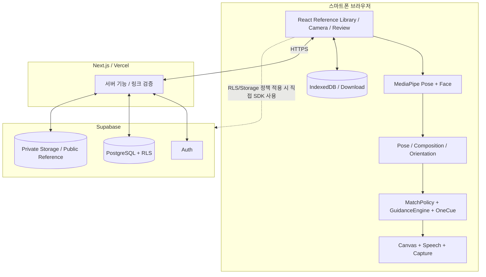
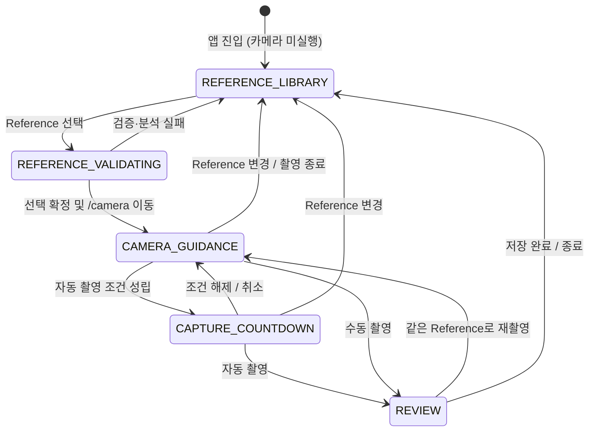
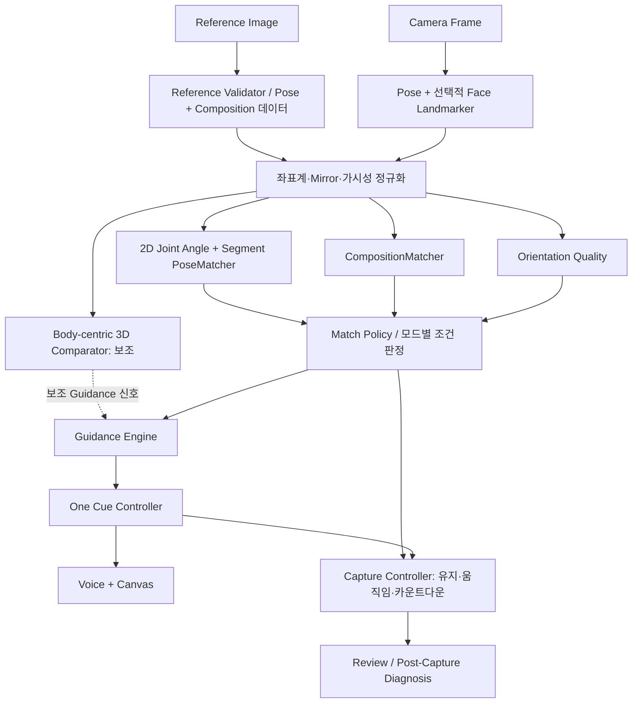

# 찰칵(Chal-Kak) — 시스템 아키텍처

> **기준**: 최종 시스템 구조 설계 · **개정**: 2026-11-22  
> 요구사항은 [`PROJECT.md`](PROJECT.md), DB/접근 정책은 [`DATABASE.md`](DATABASE.md)를 기준으로 한다. 프로토타입 모듈명은 [`PROTOTYPE_INTEGRATION.md`](PROTOTYPE_INTEGRATION.md)에서 관리한다.

## 1. 설계 원칙

1. **Mobile Web / Reference-first**: Next.js App Router + React + TypeScript로 Reference Library(`/`)를 기본 진입 UI로 구성한다. 유효한 Reference를 선택한 경우에만 Camera(`/camera`)를 실행한다.
2. **On-device Vision**: 실시간 카메라·MediaPipe·Pose/Composition Matching·Guidance·촬영은 브라우저에서 처리한다.
3. **독립된 판정과 안내**: `PoseMatcher`, `CompositionMatcher`, `MatchPolicy`, `GuidanceEngine`, `OneCueController`, `CaptureController`의 책임을 구분한다.
4. **검출 신뢰도 우선**: 가시성·인물 상태·카메라 시점의 불확실성을 확인하고 단안 3D 깊이를 정답처럼 다루지 않는다.
5. **일관된 Review**: 촬영 시점의 판정 스냅샷을 유지하고, 진단용 점수와 촬영 허용 판정을 구별한다.
6. **브라우저와 클라우드 경계**: Supabase는 계정·메타데이터·파일 보관에 사용하고 카메라 영상을 실시간 분석하기 위한 서버는 두지 않는다.
7. **명시적인 상태 전이**: Reference 선택, Guidance 일시정지, Countdown, Review, 탭 숨김을 안전하게 처리한다.

## 2. 기술 구성

| 계층·기능 | 기술 | 책임 |
|---|---|---|
| 앱 UI·라우팅 | Next.js App Router, React, TypeScript, Tailwind CSS | Reference-first Library, Camera, Review, Gallery, Share |
| 카메라·이미지 | MediaDevices API, HTMLVideoElement, Canvas 2D | 권한·영상·표시 좌표·촬영·다운로드 |
| 인체 추론 | MediaPipe Pose Landmarker | Reference / Live Pose Landmarks |
| 얼굴 추론 | MediaPipe Face Landmarker | 얼굴·눈 상태 및 방향의 선택적 신뢰도 보강 |
| 매칭·가이드 | 프로젝트 TypeScript 모듈 | 2D 관절각, Segment, Body-centric 3D 보조, 구도, MatchPolicy, One Cue |
| 음성 | Web Speech API / SpeechSynthesis | 음성 큐 출력 및 중단·대기열 제어 |
| 기기 저장 | IndexedDB / 브라우저 다운로드 | 사용자 Reference 로컬 보관 및 촬영 파일 다운로드 |
| 인증·영속 저장 | Supabase Auth, PostgreSQL, Storage | 개인 사진첩, Reference, 공유 링크 |
| 서버 API | Next.js Route Handlers / Server Functions | 공유 링크 검증·서버 권한 작업 |
| 호스팅 | Vercel | HTTPS 기반 Next.js 배포 |
| 품질 | TypeScript, ESLint, Vitest, Playwright | 정적 검사, 단위·통합·E2E 테스트 |

모델과 패키지의 실제 버전은 `package.json` 및 모델 자산 관리 정책으로 통제한다. Python 추론 서버와 OpenCV.js는 기본 아키텍처의 필수 요소가 아니다.

## 3. 물리적 실행 위치



브라우저가 Supabase에 직접 접근할 수 있는 기능과 서버의 토큰 검증이 필요한 기능을 구별한다. 서비스 역할 키와 우회 권한은 서버에만 둔다.

## 4. HCI / PD / DM 논리 계층

| 계층 | 주 책임 | 주요 설계 단위 |
|---|---|---|
| HCI | 화면 표시, 사용자 입력, 음성·Canvas 출력 | `CameraView`, `ReferenceLibrary`, `ReviewView`, `GalleryView`, `OverlayRenderer`, `VoiceOutput` |
| PD | 분석, 매칭, 행동 선택, 촬영 정책, 서비스 규칙 | `PoseDetector`, `PoseMatcher`, `CompositionMatcher`, `OrientationAnalyzer`, `MatchPolicy`, `GuidanceEngine`, `OneCueController`, `CaptureController`, `PostCaptureDiagnosis` |
| DM | 로컬/원격 데이터 저장 및 조회 | `LocalReferenceRepository`, `ReferenceRepository`, `PhotoRepository`, `ShareRepository`, Supabase Adapter |

HCI/PD/DM은 물리적 서버 구분이 아니라 책임 구분이다. PD 중 인체 추론과 촬영은 브라우저에서 수행하고, 인증·공유 서비스 일부는 서버에서 수행한다.

## 5. 디렉터리 및 모듈 경계

```text
chal-kak/
├── public/
│   ├── models/                         # MediaPipe 모델 파일
│   └── references/                     # 기본 레퍼런스 이미지
├── src/
│   ├── app/                            # Next.js 라우팅·페이지 조합
│   │   ├── layout.tsx
│   │   ├── page.tsx                    # / : Reference Library (첫 화면)
│   │   ├── camera/page.tsx
│   │   ├── review/page.tsx
│   │   ├── gallery/page.tsx
│   │   └── share/[token]/page.tsx
│   ├── components/                     # 공통 UI
│   │   ├── ui/
│   │   └── layout/
│   ├── features/                       # 기능별 구현
│   │   ├── reference/
│   │   │   ├── components/
│   │   │   └── reference-validator.ts
│   │   ├── camera/
│   │   │   ├── components/
│   │   │   └── camera-controller.ts
│   │   ├── session/
│   │   │   └── capture-session.ts
│   │   ├── pose/
│   │   │   ├── pose-matcher.ts
│   │   │   └── body-local-3d-comparator.ts
│   │   ├── composition/
│   │   │   └── composition-matcher.ts
│   │   ├── orientation/
│   │   │   └── orientation-analyzer.ts
│   │   ├── matching/
│   │   │   └── match-policy.ts
│   │   ├── guidance/
│   │   │   ├── guidance-engine.ts
│   │   │   ├── one-cue-controller.ts
│   │   │   └── voice-guidance.ts
│   │   ├── capture/
│   │   │   ├── capture-controller.ts
│   │   │   └── post-capture-diagnosis.ts
│   │   ├── gallery/
│   │   ├── sharing/
│   │   └── auth/
│   ├── lib/                            # 외부 기술 연동
│   │   ├── mediapipe/
│   │   ├── supabase/
│   │   └── local-storage/
│   └── types/                          # 공통 데이터 타입
│       ├── pose.ts
│       ├── reference.ts
│       ├── matching.ts
│       └── capture.ts
├── supabase/
│   └── migrations/
├── tests/
├── docs/
├── AGENTS.md
├── README.md
├── package.json
└── tsconfig.json
```

빈 디렉터리는 `.gitkeep`으로 추적한다. 기능 모듈과 공통 타입의 빈 파일은 구현 위치를 확보하기 위한 스캐폴드이며, 파일 존재가 기능 완성을 의미하지 않는다.


**라우팅과 상태의 소유권**

- `/`는 Reference Library다. Reference 미리보기·선택 자체가 카메라 접근을 요구하지 않는다.
- 사용자가 Reference를 선택하면 `ReferenceSelection`을 검증/활성화하고 `/camera`로 이동한다. 카메라 권한은 **CameraView가 진입한 뒤** 요청한다. 분석·검증 실패 시에는 이동하지 않는다.
- `/camera`는 공통 촬영 세션에서 `activeReferenceId`, `captureMode`, 검증된 `ReferenceData`를 확인한다. 데이터가 없거나 무효하면 `/`로 돌려보낸다.
- `/review`는 세션의 `CaptureResult`와 해당 Reference에 의존한다. 화면 전환 중 Blob/메타데이터를 유지하고, 새로고침으로 세션이 소실되었을 경우 Library로 안전하게 복귀한다.
- `features/session/capture-session.ts`는 활성 Reference·촬영 모드·촬영 결과를 라우트 사이에서 일시 유지하는 책임을 갖는다. 선택 정보는 React Context 또는 세션 저장소로 전달한다. **IndexedDB에 보관한 Reference 목록·미리보기 캐시가 곧 활성 선택을 뜻하지는 않는다.**
- Gallery와 공유 페이지는 촬영 세션과 독립적으로 접근하며, 각 리소스의 인증/공유 정책을 따른다.

**의존성 규칙**

- `app`은 페이지 조합과 라우팅을 담당하며 비교·판정 수식을 직접 갖지 않는다. 기능 전용 UI는 `features/<기능>/components`, 범용 UI는 `components/ui`와 `components/layout`에 둔다.
- `features/pose`, `composition`, `matching`, `guidance`의 핵심 판단 로직은 React·DOM·Supabase를 몰라도 테스트할 수 있게 작성한다.
- `lib/mediapipe`가 SDK의 랜드마크 반환 형식을 공통 프로젝트 타입으로 변환한다.
- `VoiceOutput`, `OverlayRenderer`, `CameraStream` 등 외부 효과는 전용 어댑터에서 수행한다.
- 기기 Reference와 계정 Reference는 Repository를 구분하되 분석 엔진에는 동일한 모델로 전달한다.
- 파일명에 `v4_6`, `v5_2`처럼 수시로 변하는 버전 번호를 붙이기보다 Git·패키지·스키마 버전으로 변경 이력을 관리한다.

## 6. 사용자 흐름과 런타임 상태



- `REFERENCE_LIBRARY`는 **카메라 스트림이 없는 최초 상태**다. 시작 시 `getUserMedia()`를 호출하지 않는다.
- `REFERENCE_VALIDATING`은 이미 캐시된 분석 데이터를 재사용할 수 있는 비동기 전이로, 실패 시 Library에 머무른다. 성공 후 추가 확인 없이 Camera로 이동한다.
- `CAMERA_GUIDANCE`는 유효한 Reference를 요구한다. `guidanceEnabled`가 false라면 같은 세션의 오버레이/음성을 잠시 끌 수 있지만 **레퍼런스 없는 독립 일반 카메라 경로는 없다**.
- Reference 변경/Library 복귀 시 추론을 중단하고 모든 `MediaStreamTrack`을 정리하며 음성과 자동 촬영 타이머를 취소한다. 비동기 `getUserMedia()`가 늦게 반환되면 이전 요청의 스트림도 즉시 폐기한다.
- `REVIEW`에서는 추론·자동 촬영·음성 출력을 중지한다. **재촬영**은 Reference를 유지해 Camera 복귀, **저장 성공 후 완료/저장 없이 완료**는 Library 복귀다. 기기 다운로드만 수행할 때는 Review를 유지해 다른 저장 동작이 가능하다.
- 카메라 권한 거부, 권한 요청 취소, 지원 불가 상황에서는 사용자에게 재시도 및 Library 복귀를 제공한다.
- 브라우저 새로고침·직접 URL 입력 후 활성 Reference가 없다면 `/camera`에서 Library로 안전하게 이동한다. 촬영 Blob이 없는 `/review`도 Library로 복귀한다.
- 탭이 숨겨질 때 음성과 자동 촬영을 취소하고 추론을 일시정지한다. 복귀 시 카메라 스트림의 유효성과 현재 상태를 재검증한다.

## 7. 공통 데이터 계약

| 계약 | 핵심 필드/책임 |
|---|---|
| `Landmark` | x/y, 선택적 z·visibility·presence, 해부학적 좌우 의미 |
| `PoseData` | 이미지 랜드마크 + 사용 가능한 world landmarks + 좌표계·미러·신뢰도 메타데이터 |
| `ReferenceData` | Reference 메타데이터, PoseData, CompositionData, 분석 버전 |
| `ReferenceSelection` | 활성 Reference ID/데이터, 촬영 모드, 선택 시각 및 유효성; Library 미리보기와 분리 |
| `CompositionData` | 인물 Bounding Box·중심·크기·프레임 기준·여백 |
| `PoseMatchResult` | 관절·Segment별 2D 오차, 검출 가능 여부, hard-match 판정, 3D 보조 비교 |
| `CompositionMatchResult` | 경계·중심·크기별 오차, 허용치 및 판정 |
| `OrientationResult` | 몸통·머리 방향, 얼굴/눈 신뢰도, 촬영 품질 게이트 |
| `MatchSnapshot` | 촬영 시각·Reference·모드·유효성·Pose/Composition/Orientation 판정의 불변 스냅샷 |
| `GuidanceAction` | actor, phase, cueKey, text, priority, 심각도 및 안정화 상태 |
| `CaptureResult` | 촬영 Blob, 시간, MatchSnapshot, Review 진단(라우트 간 일시 유지) |

타입 구현은 `src/types/`가 최종 기준이다. Pose/Landmark/Composition 데이터는 `pose.ts`, Reference 계약은 `reference.ts`, 비교 결과와 안내는 `matching.ts`, 촬영 모드와 결과는 `capture.ts`에 둔다. 기존 `pose.ts`의 비교·촬영 타입 import는 호환성을 위해 재내보내기로 유지한다. 실시간 일치 판정에 0~100 점수를 강제하지 않는다. **진단용 품질 점수**는 `PostCaptureDiagnosis`의 별도 출력으로 둘 수 있다.

## 8. 실시간 분석 및 Guidance 파이프라인

Reference 선택·검증이 성공한 뒤에만 실시간 카메라 파이프라인을 구동한다. Library의 정적 Reference 분석은 카메라 스트림 없이 수행한다.



### 8.1 Pose Matching

- 2D 관절각과 Segment 방향으로 각 부위 오차를 구하고 가시성·신뢰도·허용치를 적용한다.
- 화면상 인물 중심 및 크기와 독립적으로 자세를 비교한다.
- Body-centric 3D 비교는 MediaPipe world landmarks를 해부학적 신체 좌표계로 변환해 상대 방향을 해석한다. 단안 깊이값은 절대 거리나 발 앞뒤의 확정 근거로 사용하지 않는다.
- 3D 신호는 **보조 판정·Guidance 후보**이며, 검증 가능한 2D hard-match를 단독으로 실패 처리하지 않는다.

### 8.2 Composition Matching

- 레퍼런스 프레임과 현재 영상 프레임의 표시 비율 및 Crop을 정렬한다.
- 인물의 좌·우·상·하 경계, 중심, 크기 및 프레이밍 오차를 측정한다.
- 포즈 전용 모드는 Composition 조건을 촬영 필수 판정에 사용하지 않는다.

### 8.3 Match Policy와 Orientation Quality

- `MatchPolicy`가 각 부위의 허용 오차, 가시성, **hard-match** 조건과 Review의 `일치/대체로 일치/보정 필요/분석 불가` 기준을 중앙 관리한다.
- 촬영 중 `hardMatched` 여부를 스냅샷에 기록해 Review에서도 동일한 의미의 `일치`를 사용한다.
- 방향 보정은 신뢰 가능한 몸통·얼굴 방향을 참고하며, 얼굴 모델이 없거나 신뢰도가 낮으면 Pose 기반 보조 판단으로 대체하거나 해당 항목을 보류한다.
- 신뢰할 수 없는 얼굴/눈 정보만으로 자동 촬영을 무조건 실패시키지 않는다.

### 8.4 Guidance Engine과 One Cue

- `GuidanceEngine`은 인물 검출 → 구도 → 팔다리 → 몸통·머리/눈 등의 **행동 후보**를 생성하고 시정 효과·심각도·역할(촬영자/피사체)에 따라 우선순위를 정한다.
- `OneCueController`는 후보 가운데 **한 가지**를 선택하고, cue 반복 제한·행동 안정화·음성 겹침을 제어한다.
- 일반 안내는 이전 문장을 불필요하게 끊지 않고, 촬영 직전의 중요한 Cue는 상황에 따라 중단할 수 있다.
- Canvas는 **Target Skeleton / Composition Frame / 판정 표시**를 그리며, Reference 원본 이미지를 반투명하게 덮는 방식에 의존하지 않는다.

### 8.5 수동 촬영과 Auto Shoot

- 수동 촬영은 사용자의 입력으로 가능하다.
- Auto Shoot는 모드별 required-match, Orientation gate, 인물 움직임, 유지 시간·카운트다운을 함께 확인한다.
- Reference 변경·Library 복귀, 가이드 일시정지, 탭 숨김, Review 진입, 촬영 중복 등의 경우 대기 중인 자동 촬영을 취소한다.
- Auto Shoot의 수치(유지 시간·간격·속도)는 중앙 설정/정책으로 다루고 실기기에서 보정한다.

## 9. Reference 검증, 로컬 저장, 클라우드 저장

### Reference 등록

1. 이미지 파일 형식·크기·해상도 유효성 확인.
2. 정적 이미지 `Pose Landmarker`로 인물 수와 Landmark/World Landmark 추출.
3. 한 명의 주 피사체, 전신 관절 가시성, 인물 크기, 크롭, 비정상적인 관절 기하 검증.
4. 공통 `ReferenceData`와 2D/3D 보조 분석 데이터를 생성.
5. Local Reference Repository(IndexedDB) 또는 사용자 계정 Reference Repository(Supabase)로 저장.

Reference의 **저장 위치**는 분석 엔진의 인터페이스를 바꾸지 않는다. 모델·분석 스키마 버전이 변경되면 캐시를 재분석하거나 안전하게 무효화한다.

### 클라우드 영역

- Supabase Auth: 로그인과 소유권 식별.
- PostgreSQL: 사진/레퍼런스 메타데이터, 분석 결과, 공유 링크 상태.
- Storage: 공개 샘플 Reference 및 사용자 비공개 이미지 버킷.
- Next.js 서버 기능: 공유 토큰 유효성/소유권 검증, 제한된 다운로드 접근.
- 실시간 카메라 스트림은 명시적 저장·전송을 제외하면 클라우드에 올리지 않는다.

## 10. 촬영 후 진단(Post-Capture Diagnosis)

- `CaptureController`는 촬영 직전의 `MatchSnapshot`을 고정해 Review 도중 측정 결과가 바뀌지 않게 한다. Review로 이동해도 촬영 Blob과 Reference 컨텍스트는 해당 촬영 세션에 유지한다.
- `PostCaptureDiagnosis`는 포즈 오차, 프레이밍, 몸통·얼굴 방향, 눈 상태 및 추정 선명도를 평가한다.
- 출력: `일치/대체로 일치/보정 필요/분석 불가`, 주된 수정 항목, 재촬영 권고, 선택적 진단용 품질 점수.
- **실시간 hard-match**와 **Review의 참고 점수**를 동일한 계산으로 오해하지 않는다.
- 촬영 사진의 기기 다운로드는 클라이언트에서, 개인 사진첩 저장/공유는 인증·저장 정책을 통해 처리한다.

## 11. 좌표계·성능·안정성

- 원본 카메라 좌표, MediaPipe 이미지 정규화 좌표, Canvas의 표시/Crop 좌표를 구분한다.
- 전면 카메라의 시각적 좌우 반전과 해부학적 Landmark의 Left/Right 의미 교환은 별도 처리한다.
- 영상이 실제로 바뀐 경우에만 재추론하는 등 불필요한 반복 계산을 제한한다.
- Pose/Face 추론의 실행 주기와 해상도를 분리하고 모바일 FPS·발열·배터리 영향을 실측한다.
- `detectForVideo`와 같은 동기 처리로 메인 스레드가 길게 차단되는지 검증하고, 필요 시 추론 분리 또는 작업 스케줄을 개선한다.
- `visibilitychange`, 카메라 권한 거부, Library/Review 이동, 장치 교체와 미완료 비동기 카메라 요청을 안전하게 처리한다.
- 브라우저 API는 Client Component 및 클라이언트 전용 모듈에서만 호출한다.

## 12. 문서·코드 변경 관리

- 공통 타입, Match Policy, 상태 전이, RLS/Storage 경계를 변경하는 PR은 관련 문서를 함께 업데이트한다.
- 프로토타입의 **순수 계산 로직과 회귀 테스트 케이스**는 재사용하되, `app.js`의 직접 DOM 접근/전역 상태/이벤트 바인딩은 React 컴포넌트·훅으로 재구성한다.
- `PROTOTYPE_INTEGRATION.md`는 원본과 이식 방향을 연결하는 개발 참고 문서이고, 본 문서는 **최종 설계 기준**이다.
- GitHub Issues/Projects가 작업 상태의 기준이며, 이 문서에 개발 단계나 담당자 현황을 중복 기재하지 않는다.

## 관련 문서

- [제품 요구사항](PROJECT.md)
- [DB 및 접근 정책](DATABASE.md)
- [프로토타입 구조·이식 가이드](PROTOTYPE_INTEGRATION.md)
- [개발 가이드](DEVELOPMENT.md)
- [협업 규칙](CONTRIBUTING.md)
