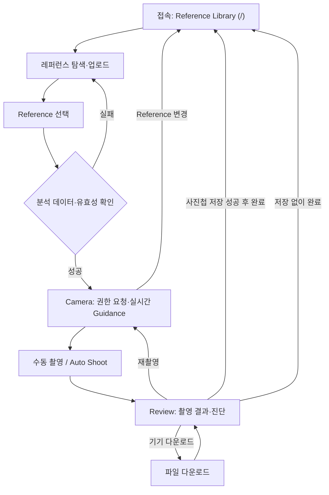

# 찰칵(Chal-Kak) — 제품 정의와 요구사항

> **기준**: 최종 제품의 요구사항 · **개정**: 2026-11-22  
> 본 문서는 구현 진척도가 아닌 **제품 동작과 수용 기준**을 정의한다. 작업 상태는 GitHub Issues/Projects에서 관리한다.

## 1. 제품 개요

찰칵은 **레퍼런스 인물 사진과 비슷한 포즈 또는 인물 중심 구도로 촬영하도록 실시간으로 도와주는 모바일 웹 서비스**다. 사용자는 별도의 앱 설치 없이 스마트폰 브라우저의 Reference Library에서 원하는 사진을 먼저 선택하고, 이후 카메라 화면에서 목표 스켈레톤·프레이밍과 음성 중심의 One Cue를 참고해 촬영한다. 촬영 후에는 결과 진단, 재촬영, 기기 다운로드, 개인 사진첩 저장 및 공유를 사용할 수 있다.

### 핵심 원칙

1. **Reference-first**: 앱에 진입하면 Reference Library를 먼저 보여준다. 선택된 유효한 Reference가 있을 때만 카메라 촬영 화면으로 진입한다.
2. **On-device Analysis**: 카메라 프레임과 실시간 포즈 분석은 원칙적으로 스마트폰 브라우저에서 처리한다.
3. **Pose와 Composition의 분리**: 자세 비교와 프레이밍 비교는 독립적인 결과를 갖는다.
4. **One Cue**: 사용자에게 한 번에 하나의 우선순위 높은 수정 행동을 안내한다. 일반 촬영 화면에 장문의 자막 배너를 상시 표시하지 않는다.
5. **촬영과 저장의 분리**: 촬영, 기기 다운로드, 클라우드 사진첩 저장은 서로 다른 동작이다.

## 2. 사용자 흐름

- **첫 화면 `/`은 Reference Library**다. 레퍼런스 목록·미리보기·사용자 이미지 추가·선택 기능을 제공한다. 카메라 스트림과 카메라 권한 요청은 시작하지 않는다.
- **선택 즉시 이동**: 사용자가 Reference를 선택하면 이미 분석된 데이터는 재사용하고, 필요한 경우에만 분석·검증한다. 성공 시 추가 시작 버튼 없이 `/camera`로 이동해 카메라를 실행한다. 실패하면 Library에 머물며 구체적인 오류를 표시한다.
- **촬영 화면 `/camera`**는 유효한 Reference가 있을 때만 접근한다. 실시간 가이드, 전·후면 전환, 미러, 음성·Auto Shoot 설정과 Reference 변경 기능을 제공한다.
- **Reference 변경/뒤로 가기**로 Library에 돌아가면 스트림·추론·음성·대기 중인 자동 촬영을 정리한다. 선택 기록은 미리보기에 사용할 수 있지만, 새 세션에서 자동 촬영이나 무단 카메라 재개를 유발하지 않는다.
- **Review `/review`**에서 재촬영을 누르면 기존 Reference와 촬영 모드를 유지한 채 Camera로 돌아간다. 기기 다운로드는 별개의 저장 동작이며, 저장 성공 후 완료 또는 저장 없이 완료를 선택하면 Library로 복귀한다. 저장 실패 시에는 Review를 유지한다.
- URL로 `/camera`에 직접 접근하거나 페이지를 새로고침했는데 유효한 선택 데이터가 없다면 Library로 이동한다. `/review`는 촬영 결과가 없으면 Review를 열지 않는다.
- 촬영 중 가이드를 일시 정지하더라도 Reference 선택은 유지된다. **Reference 없이 시작하는 일반 카메라 진입 경로는 제공하지 않는다.**

## 3. 촬영 모드와 비교 범위

### 3.1 포즈 따라하기 — Pose Matching

- 레퍼런스와 현재 인물의 **2D 관절각, 신체 Segment 방향 및 유효한 Landmark**를 비교한다.
- 이미지 속 인물의 절대 좌표, 화면상 크기, 여백은 포즈 일치 판정의 직접적인 기준이 아니다.
- 본체 중심 기준 변환·정규화를 사용하며, 카메라 시점·가림·낮은 신뢰도로 인한 불확실성을 별도로 다룬다.
- **Body-centric 3D 비교**는 팔·다리 방향 또는 상대 깊이 해석을 돕는 보조 신호로 사용한다. 단안 카메라에서 추정된 깊이를 절대적인 참값으로 보지 않는다.

### 3.2 사진 전체 따라찍기 — Pose + Composition Matching

- Pose Matching에 추가로 **인물 Bounding Box의 중심·크기·상하좌우 경계·여백·프레이밍**을 비교한다.
- Composition 결과는 Pose 결과와 분리해서 계산하며, 촬영 모드가 요구하는 항목만 최종 판정에 적용한다.
- 배경의 물체 위치를 정밀 정합하거나 카메라의 3D 공간 위치를 재구성하는 기능을 의미하지는 않는다.

## 4. 기능 요구사항

| ID | 기능 | 요구사항 |
|---|---|---|
| FR-01 | Reference-first | 앱 진입 시 Reference Library를 첫 화면으로 제공하고, 선택 전에는 카메라를 실행하거나 권한을 요청하지 않는다. |
| FR-02 | Reference Library | 제공·사용자 Reference를 탐색·업로드·선택한다. 유효한 Reference 선택 시 별도 시작 단계 없이 Camera로 이동한다. |
| FR-03 | Reference 가져오기 | 사용자는 이미지 파일을 등록·삭제하고, 저장된 Reference를 다시 사용할 수 있다. |
| FR-04 | Reference 유효성 | 단일 주 피사체·충분한 전신 Landmark·가시성·기하학적 유효성을 검증하고 부적합한 이미지는 이유를 안내한다. |
| FR-05 | Reference 분석·캐시 | Reference 이미지에서 Pose/Composition 및 사용 가능한 3D 보조 정보를 생성하고 동일 이미지의 반복 분석을 줄인다. |
| FR-06 | Live Pose | 카메라 프레임에서 실시간 Pose Landmark를 검출한다. |
| FR-07 | 촬영 모드 | 포즈 따라하기와 사진 전체 따라찍기를 구분하여 선택할 수 있다. |
| FR-08 | Pose Matching | 2D 관절각 및 Segment 방향 오차·가시성·허용 범위에 따라 부위별 판정을 반환한다. |
| FR-09 | Composition Matching | 인물 위치·크기·경계·여백을 목표 Reference와 비교한다. |
| FR-10 | 보조 방향 분석 | 몸통·머리 방향, 얼굴 및 눈 상태가 신뢰 가능한 경우 촬영 가이드와 품질 판단에 활용한다. 신뢰할 수 없는 얼굴 신호만으로 일치를 실패 처리하지 않는다. |
| FR-11 | 시각 가이드 | Target Skeleton, Composition Frame, 현재 상태를 카메라 영상 위에 표시한다. |
| FR-12 | One Cue | 우선순위 높은 한 가지 행동을 선택하며, 흔들림·반복·안내 충돌을 억제한다. |
| FR-13 | 음성 안내 | One Cue를 음성으로 출력하고, 사용자가 음성 출력을 켜고 끌 수 있다. |
| FR-14 | 수동 촬영 | 사용자는 매칭 상태와 관계없이 직접 사진을 촬영할 수 있다. |
| FR-15 | Auto Shoot | 필요한 조건이 일정 시간 유지되고 움직임이 충분히 안정적일 때 카운트다운 후 촬영한다. 중단·상태 변경·중복 촬영을 안전하게 처리한다. |
| FR-16 | Review | 촬영 직후 사진과 포즈·구도·방향·품질 진단을 확인한다. 재촬영은 같은 Reference로 Camera 복귀, 완료는 Library 복귀를 제공한다. |
| FR-17 | 저장 | 촬영 이미지를 기기에 다운로드할 수 있고 인증한 사용자는 개인 사진첩에 저장할 수 있다. |
| FR-18 | 인증·사진첩 | 로그인·로그아웃과 본인 사진/Reference 목록 조회·삭제를 제공한다. |
| FR-19 | 공유 | 사용자는 본인 사진의 공유 링크를 생성·철회할 수 있으며 링크는 설정된 권한을 따른다. |
| FR-20 | 미러 | 카메라 미리보기 좌우 반전과 Landmark의 좌·우 의미 변환을 구별해 처리한다. |
| FR-21 | 런타임 안정성 | Reference 선택·변경, 카메라/Review 이동, 카운트다운, 탭 숨김 시 추론·음성·타이머·스트림을 안전하게 정리한다. 직접 URL 진입도 보호한다. |
| FR-22 | 오류 안내 | 권한 거부, 인물 미검출, 잘못된 Reference, 분석·저장·네트워크 실패를 이해 가능한 문구로 안내한다. |

## 5. Reference 등록 정책

- 기본 분석 단위는 **한 명의 인물**이다. 여러 인물이 검출되거나 필수 관절이 누락된 경우 자동으로 잘못된 포즈를 등록하지 않는다.
- 이미지 용량·해상도·가시성·과도한 크롭·작은 인물 크기 등을 검증한다.
- 사용자 Reference의 **로컬 보관**은 IndexedDB 같은 브라우저 저장소로 지원할 수 있고, **계정 기반 보관**은 Supabase Storage 및 PostgreSQL과 연동한다.
- 로컬 Reference와 클라우드 Reference는 공통 `ReferenceData` 계약으로 분석 엔진에 전달한다.
- 개발용 분석·검증 패널은 일반 사용자 UI와 분리한다.

## 6. Guidance 및 촬영 정책

- **Match Policy**는 부위별 허용 오차, 가시성, 구도 조건과 촬영 판정을 정의하는 **단일 기준**이다.
- **Guidance Engine**은 매칭 결과와 사용자·촬영자 역할을 고려하여 보정 행동 후보를 정렬한다.
- **One Cue Controller**는 안정화 시간, 반복 간격, 음성 충돌을 제어해 한 문장의 안내를 선택한다.
- 음성 안내는 촬영 화면의 주된 행동 피드백이며, 시각 요소는 Skeleton/Frame과 촬영 상태에 집중한다.
- **Auto Shoot**는 단순한 0~100 점수에 의해 작동하지 않고 매칭·움직임·자세 유지·카운트다운 조건으로 동작한다.
- **Review**는 촬영 당시 확정한 판정 상태를 보존하고 추가 진단을 제공한다. 진단용 점수는 실시간 촬영 허용 여부의 단일 대체 기준이 아니다.
- Review에서 재촬영을 선택하면 필요한 수정 행동을 다시 안내할 수 있다.

## 7. 개인정보 및 저장 정책

- 실시간 카메라 영상은 사용자의 명시적 저장/전송 동작 없이 서버로 지속 업로드하지 않는다.
- 비회원은 공개·로컬 Reference 탐색, Reference 선택 후 카메라 촬영, 기기 다운로드를 사용할 수 있다.
- 개인 클라우드 사진첩, 개인 Reference의 계정 간 동기화 및 공유 링크 관리는 인증을 요구한다.
- 개인 사진·Reference는 기본 비공개로 저장하고, 공개 Reference 카탈로그만 별도의 읽기 정책으로 제공한다.
- 공유 링크는 유효성·만료·철회 조건을 확인한 후 제한적으로 사진에 접근하도록 한다.
- 3D·얼굴 분석 데이터는 기능에 필요한 최소 범위에서만 처리하고, 원본 얼굴 Landmark를 불필요하게 서버에 보관하지 않는다.

## 8. 비기능 요구사항

| ID | 영역 | 검증할 기준 |
|---|---|---|
| NFR-01 | 플랫폼 | iOS Safari / Android Chrome 실기기에서 카메라·Canvas·음성 기능 검증 |
| NFR-02 | 반응성 | 추론으로 인해 기본 카메라·UI가 과도하게 멈추지 않아야 함 |
| NFR-03 | 신뢰성 | 레퍼런스 없는 카메라 진입, 중복 촬영, 비활성 탭 자동 촬영, 잘못된 상태 전이 방지 |
| NFR-04 | 성능 | 추론 FPS, 가이드 반영 지연, 메모리·발열·장시간 안정성 측정 |
| NFR-05 | 보안 | 인증·RLS·Storage 정책, 파일 검증, 서버 비밀 키 보호 |
| NFR-06 | 정확성 | 촬영 중 Match와 Review 판정 기준의 일관성 |
| NFR-07 | 테스트 | 핵심 매칭·상태 전이·Reference 검증을 자동화된 단위/통합 테스트로 검증 |
| NFR-08 | 유지보수 | React UI와 순수 비교 알고리즘, 외부 SDK, 영속 저장의 책임 분리 |

최저 지원 OS, 허용 FPS·지연, 이미지 제한값 등 수치는 실기기 검증 및 운영 정책으로 확정한다. 프로토타입의 임계값을 검증 없이 최종 성능 보장치로 사용하지 않는다.

## 9. 문서와 개발의 관계

- 이 문서: 최종 제품의 사용자 요구사항 기준
- [`ARCHITECTURE.md`](ARCHITECTURE.md): 시스템 책임·모듈·파이프라인
- [`DATABASE.md`](DATABASE.md): 저장 모델·권한
- [`PROTOTYPE_INTEGRATION.md`](PROTOTYPE_INTEGRATION.md): 최신 프로토타입에서 확인된 구현과 이식 참고 사항
- 작업 범위/우선순위/담당자: GitHub Issues/Projects
